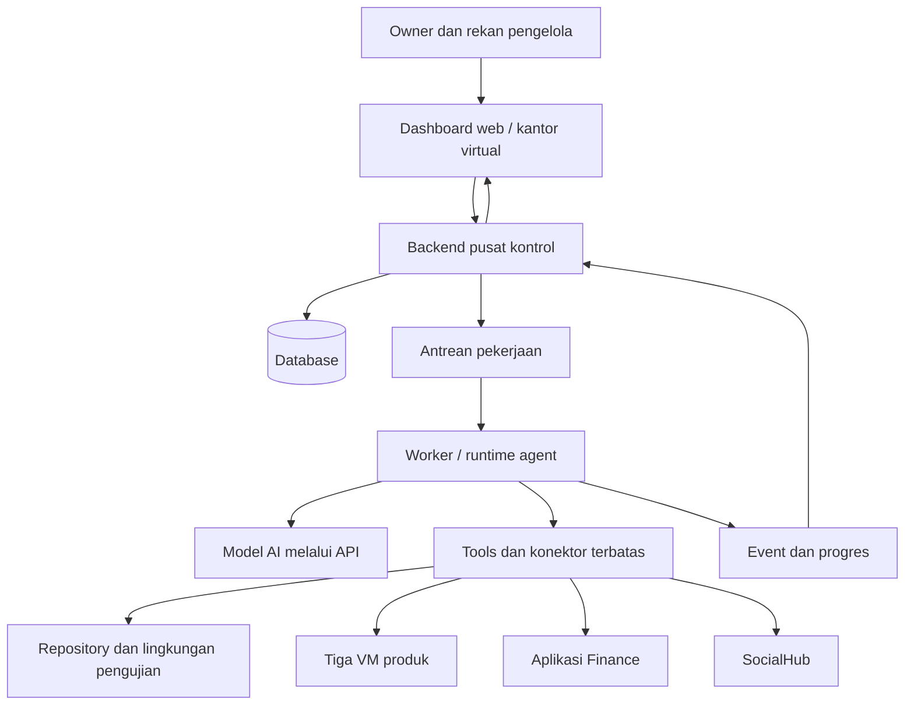

# Gennexbyte HQ — Planning

Tanggal: 2 November 2026 · Zona waktu operasional: Asia/Jakarta

## 1. Tujuan dan status

Membangun platform web sebagai kantor virtual dan pusat kontrol AI agent Gennexbyte. Pemilik dan rekan pengelola dapat memberikan instruksi, memantau pekerjaan, meninjau hasil, dan mengambil keputusan melalui browser.

Dokumen ini adalah planning, bukan aplikasi yang sudah berjalan. Implementasi akan dilanjutkan pada VPS milik pemilik. Contoh peran, nama teknis, kontrak, dan tahapan di bawah merupakan usulan; pilihan yang belum diputuskan dicatat di bagian akhir.

Autonomous berarti agent mampu menjalankan langkah-langkah suatu pekerjaan di dalam wewenangnya, menyimpan progres, dan melaporkan hasil tanpa diarahkan pada setiap langkah. Agent harus dapat berhenti ketika memerlukan keputusan, mencapai batas, atau tidak dapat melanjutkan dengan aman.

## 2. Infrastruktur yang diketahui

| VM | Beban yang disebutkan pemilik |
| --- | --- |
| VM 1 | Website Gennexbyte, NxBooth, dan aplikasi Gennexbyte |
| VM 2 | NxChat / chatbot |
| VM 3 | platform SocialHub dan aplikasi lain yang akan dikembangkan |

OS, CPU, RAM, penyimpanan, metode deployment, repository produk, dan topologi jaringan belum diperiksa. Lokasi pusat kontrol dan worker belum ditetapkan; jangan mengasumsikan VM 3 cukup untuk menampung semua agent.

Agent tidak harus satu per VM. Satu produk dapat melibatkan beberapa peran; aksesnya dibatasi per project dan tindakan.

## 3. Ruangan dalam satu lantai

Tampilan utama berupa satu lantai luas dengan ruangan, bukan gedung bertingkat. Area produk dan departemen dapat dipisahkan oleh koridor bersama. Ruang Director menjadi area rapat pengelola. Layout final dapat ditentukan saat desain.

| Ruangan | Tanggung jawab | Integrasi yang dibutuhkan |
| --- | --- | --- |
| Gennexbyte | Website, platform utama, fitur, dan operasional produk | Repository, pengujian, log, deployment |
| NxChat | Pengembangan dan operasional chatbot | Repository NxChat dan tools operasionalnya |
| NxBooth | Pengembangan dan operasional NxBooth | Repository NxBooth dan tools operasionalnya |
| SocialHub | Membangun dan mengoperasikan platform SocialHub | Repository dan backend SocialHub |
| Innovation / Apps | Aplikasi baru; dapat memperoleh ruangan sendiri kemudian | Repository dan lingkungan project baru |
| Finance | Catatan pemasukan/pengeluaran, perhitungan, anggaran, rekonsiliasi, dan laporan | Aplikasi finance yang akan dibangun |
| Marketing | Rencana kampanye, konten, promosi, dan pengelolaan media sosial | SocialHub sebagai jalur operasional |
| Director | Diskusi, prioritas, strategi, usulan, dan keputusan pemilik bersama rekan pengelola | Akun manusia, rapat, keputusan, dan persetujuan |

Tim SocialHub mengembangkan aplikasinya; Marketing menggunakan aplikasi tersebut. Finance bekerja lintas produk melalui aplikasi finance, bukan membuat sumber transaksi terpisah di dashboard.

Director merupakan ruang manusia. Agent koordinator dapat membantu merangkum rapat dan menindaklanjuti keputusan; kewenangan keputusan mengikuti aturan pengelola.

## 4. Kontrol web

### Tampilan kantor

- Karakter mewakili agent dan meja/ruangan menunjukkan penempatan tim.
- Klik ruangan: anggota, target, pekerjaan, aplikasi terhubung, dan kendala.
- Klik agent: chat, tugas aktif, riwayat, tools, akses, dan batas penggunaan.
- Status berasal dari backend; tampilkan kapan terakhir diperbarui.
- Bedakan idle dari offline atau status kedaluwarsa.
- Sediakan daftar/tabel sebagai alternatif denah untuk layar kecil dan akses keyboard.

### Chat dan pekerjaan

- Instruksi dapat ditujukan ke project, agent, atau koordinator.
- Instruksi yang memerlukan tindakan menjadi tugas tersimpan dengan ID dan kriteria selesai.
- Tampilkan progres, aktivitas tool yang relevan, hasil, preview, dan permintaan keputusan.
- Pengelola dapat menambahkan arahan, pause, resume, atau cancel.
- Status pause/cancel baru final setelah worker mengonfirmasi; operasi yang sedang berlangsung mungkin perlu diselesaikan dahulu.
- Tugas tetap berjalan ketika browser ditutup.

### Papan pekerjaan

Usulan status tugas:
draft → queued → running → waiting_approval / blocked → succeeded / failed / cancelled.

Pause memiliki requested/acknowledged state tersendiri. Status agent (working, idle, waiting_user, error, offline) tidak menggantikan status tugas. Agent dengan tugas selesai dapat kembali idle sementara tugas tetap succeeded.

Setiap tugas menyimpan project, penanggung jawab, instruksi, kriteria penerimaan, prioritas, batas biaya/durasi, dan hasil. Handoff antaragent harus tercatat.

### Director dan persetujuan

- Diskusi dan catatan rapat bersama pengelola.
- Daftar usulan, alasan, dampak, biaya, serta hasil yang akan dipublikasikan atau diterapkan.
- Hak owner/director/member dapat diatur; jumlah persetujuan mengikuti jenis tindakan.
- Persetujuan mengacu pada tindakan, target, dan versi hasil tertentu.
- Perubahan payload setelah persetujuan memerlukan evaluasi persetujuan baru.
- Keputusan dicatat bersama identitas, waktu, alasan, dan tindak lanjut.

### Finance

Dashboard menampilkan ringkasan dan tautan detail dari aplikasi finance. Catatan transaksi mempunyai bukti, sumber, project, kategori, nilai, mata uang, waktu, dan status rekonsiliasi.

Agent boleh menyiapkan laporan dan usulan anggaran sesuai akses. Pembayaran, perubahan rekening, serta koreksi transaksi final memerlukan kebijakan tersendiri. API harus menolak pencatatan ganda pada percobaan ulang.

### Marketing

Marketing membuat brief, kalender konten, draft, dan laporan performa. Penjadwalan serta publikasi dilakukan melalui SocialHub. Draft, persetujuan, jadwal, dan hasil publikasi mempunyai status berbeda. Kegagalan koneksi tidak boleh ditampilkan sebagai publikasi berhasil.

### Pengaturan

Roster agent, penempatan ruangan, instruksi peran, tools, akses project, model/provider, jadwal, anggaran penggunaan, dan koneksi aplikasi. Tampilkan estimasi dan penggunaan aktual secara terpisah; data yang tidak tersedia ditandai tidak diketahui.

## 5. Arsitektur usulan



Backend dan worker adalah komponen logis; pemisahan fisik mengikuti kapasitas dan kebutuhan isolasi.

- Backend: autentikasi, izin, task API, kebijakan tindakan, dan persetujuan.
- Database: sumber utama tugas, chat, keputusan, hasil, dan audit.
- Antrean: mengatur pekerjaan, lease/heartbeat worker, dan percobaan ulang terbatas.
- Worker: menjalankan loop agent dan tools, menulis checkpoint, menangani stop, serta mengirim progres.
- Model AI: menyusun langkah dan memilih tools; keputusan akses tetap ditegakkan oleh aplikasi.
- Tools: API atau runner dengan akses terbatas untuk repository, tes, log, finance, SocialHub, dan deployment.
- Event stream: mengirim perubahan ke browser; pengguna yang reconnect mengambil snapshot lalu melanjutkan dari cursor.
- Penyimpanan artefak: hasil, laporan, dan preview dengan akses sesuai project.

SSE atau WebSocket dapat digunakan untuk pembaruan web. Pemilihan framework, database, antrean, dan runtime belum final.

## 6. Hubungan dengan prompt ntfy

Prompt referensi mengirim roster, tampilan karakter, kelompok, chat link, jadwal, status, dan penggunaan ke feed. Itu memberi inspirasi bentuk dashboard; belum menyediakan keseluruhan sistem instruksi dan eksekusi.

Untuk Gennexbyte:
- Ruangan menggantikan floor/group.
- ID agent stabil menjadi identitas; nama dapat berubah.
- Chat link menuju halaman agent internal, bukan skema deep link Grok.
- Dashboard membaca backend sendiri agar status dan riwayat tersimpan.
- ntfy opsional sebagai kanal notifikasi tambahan.
- URL topic acak tidak menjadi pengganti autentikasi dan otorisasi.
- Jangan mengirim rahasia, isi transaksi, atau data pelanggan ke feed publik.
- Jangan menyalin langkah prompt untuk mengubah shared memory atau membuat jadwal sebelum sistem dan kebutuhannya ditetapkan.

## 7. Data dan kontrak awal

Entitas inti yang diusulkan:
users, memberships, rooms, projects, agents, agent_project_permissions, conversations, messages, tasks, task_runs, tool_calls, approvals, decisions, schedules, events, artifacts, integrations, usage_records.

Finance menyimpan data bisnis utamanya pada aplikasi finance; HQ dapat menyimpan referensi dan cache ringkasan.

Contoh event usulan, bukan endpoint yang sudah tersedia:

```json
{
  "schema_version": 1,
  "event_id": "evt_unique",
  "agent_id": "agent_nxchat_dev",
  "task_id": "task_042",
  "run_id": "run_003",
  "sequence": 12,
  "type": "agent.status_changed",
  "occurred_at": "2026-11-02T09:00:00+07:00",
  "data": {
    "status": "working",
    "step": "Menjalankan pengujian login NxChat"
  }
}
```

Backend memvalidasi struktur, identitas worker, izin, ukuran, dan urutan event. event_id dipakai untuk deduplikasi. Jangan memasukkan API key, token, atau isi data sensitif ke step.

Usulan API: membuat/membaca tugas, mengirim arahan, meminta pause/cancel, mengirim keputusan, membaca agent/ruangan, dan berlangganan event. Worker harus memakai identitas tersendiri; browser tidak memegang credential VM atau model.

## 8. Operasional dan batas otonomi

- Login pengelola; peran dan izin ditegakkan di backend serta tools.
- Worker memakai akun layanan dengan akses minimum per lingkungan.
- Pengembangan kode dijalankan dalam workspace terpisah; sumber produksi tidak menjadi workspace default.
- Tools baca log, ubah kode, publish konten, catat transaksi, dan deploy memiliki izin terpisah.
- Batas biaya/durasi/percobaan enforced oleh runtime; bukan hanya instruksi dalam prompt.
- Jadwal memakai Asia/Jakarta untuk pengguna; waktu disimpan konsisten dengan zona/offset.
- Retry hanya untuk tindakan yang aman diulang; gunakan idempotency key atau pemeriksaan hasil untuk efek eksternal.
- Setelah crash, rekonsiliasi tindakan terakhir sebelum melanjutkan agar tidak menggandakan pembayaran, publikasi, atau deployment.
- Pisahkan instruksi pemilik dari konten tak tepercaya yang dibaca dari web, issue, file, atau pesan pelanggan.
- Rahasia disimpan sebagai secret pada server; repo berisi contoh konfigurasi tanpa nilainya.
- Audit siapa meminta, menyetujui, menjalankan, dan hasilnya.
- Backup database dan artefak penting serta uji pemulihannya.
- Pantau health pusat kontrol dari luar hostnya agar gangguan host tetap terdeteksi.
- Tombol stop global menghentikan penerimaan tugas baru dan meminta worker menghentikan pekerjaan; bukan janji membatalkan efek yang sudah terjadi.

## 9. Contoh alur

### Pengembangan NxChat

Owner memberi tugas beserta kriteria selesai → developer membaca repository → perubahan dibuat di branch/workspace terpisah → tes dan preview → laporan dan permintaan rilis bila diwajibkan → deployment pada revisi yang disetujui → health check → hasil akhir.

Jika tes gagal, agent mencoba perbaikan dalam batas yang ditetapkan. Jika tidak selesai, tugas ditandai failed/blocked dengan bukti dan pertanyaan konkret.

### Kampanye NxBooth

Director meminta promosi dengan anggaran Rp2 juta → Marketing menyusun brief → Finance memeriksa usulan anggaran → Director memutuskan → Marketing membuat konten dan jadwal di SocialHub → publikasi mengikuti izin → Finance/Marketing melaporkan biaya dan hasil aktual.

## 10. Tahapan pembangunan dan kriteria selesai

1. **Inventarisasi dan keputusan dasar.** Catat kapasitas VM, stack aplikasi, repo, staging, API SocialHub, aplikasi finance yang direncanakan, pengelola, dan kebijakan tindakan. Hasil: diagram penempatan dan daftar akses.
2. **Pusat kontrol dasar.** Login, delapan ruangan, roster agent, tugas, catatan keputusan, dan database. Data demo berlabel. Hasil: dua pengelola dapat melihat catatan yang sama; data bertahan setelah restart.
3. **Satu agent nyata untuk NxChat.** Worker, model API, tools repository/tes, checkpoint, biaya, stop, dan laporan. Hasil: satu tugas uji sampai selesai dari browser tanpa SSH manual; pemulihan worker diuji.
4. **Persetujuan dan rilis.** Preview, persetujuan terikat revisi, deployment terkontrol, health check, dan rollback yang ditetapkan. Hasil: tindakan di luar izin ditolak dan deployment tidak terulang karena retry.
5. **Perluasan tim dan produk.** Tambahkan QA, operasional, dan produk lain setelah alur satu agent terbukti. Hasil: handoff tercatat dan akses project tidak tertukar.
6. **Marketing dan Finance.** Integrasi API SocialHub dan aplikasi finance, rekonsiliasi, persetujuan publikasi/keuangan. Hasil: status cocok dengan aplikasi sumber dan retry tidak menggandakan aksi.
7. **Pengalaman kantor lengkap.** Denah satu lantai, karakter, animasi status, pencarian, dan tampilan mobile. Denah sederhana dapat tersedia lebih awal; detail visual mengikuti fondasi operasional.

## 11. Keputusan terbuka sebelum implementasi

- Spesifikasi dan OS ketiga VM; Docker/PM2/systemd atau metode lain.
- Repository setiap produk dan keberadaan staging.
- Penempatan pusat kontrol, worker, dan workspace pengembangan.
- Framework frontend/backend serta database dan antrean.
- Provider/model AI dan anggaran pemakaian.
- Jumlah pengelola, peran, dan aturan persetujuan per tindakan.
- API dan autentikasi SocialHub; kesiapan aplikasi finance.
- Agent pertama, tugas uji, dan definisi berhasilnya.
- Domain, autentikasi, backup, serta penyimpanan artefak.
- Apakah setiap agent bisa menangani beberapa pekerjaan atau satu pekerjaan aktif.

## 12. Catatan handoff

Mulai sesi implementasi dengan membaca README dan dokumen ini, memeriksa repository serta lingkungan VPS, lalu menutup keputusan yang menghalangi fase pertama. Jangan menganggap integrasi, runtime, desain final, dan deployment sudah ada. Jangan membawa credential, identitas hosting percobaan, atau draft aplikasi yang belum selesai ke repository ini.
